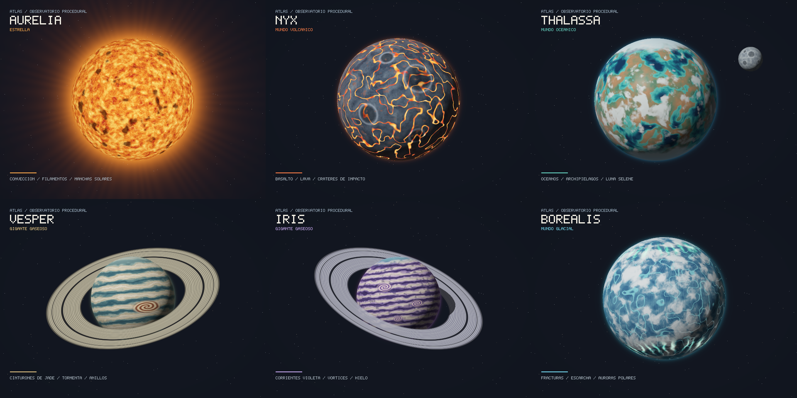
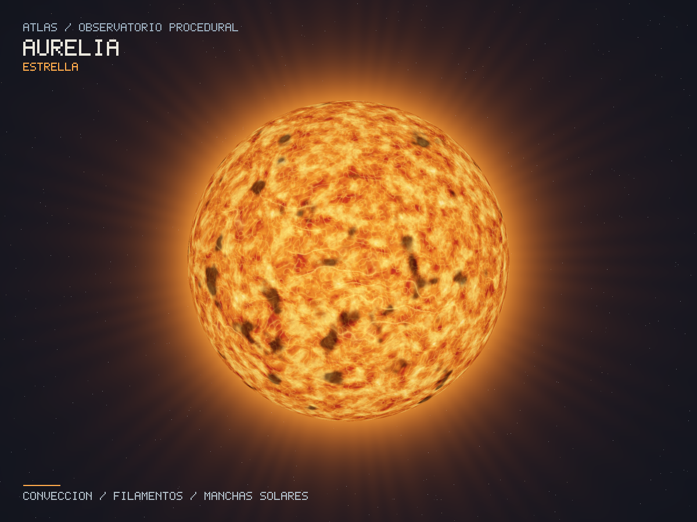
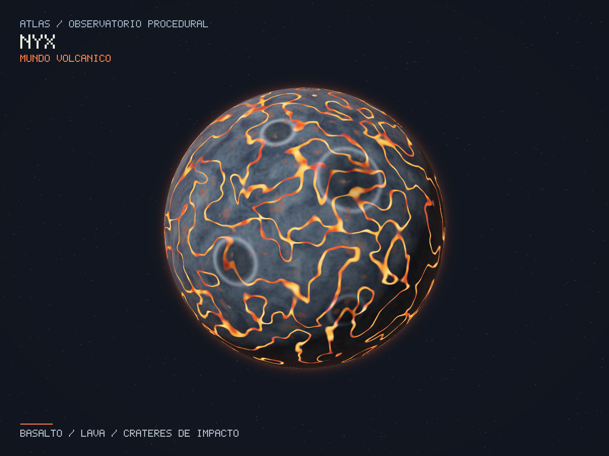
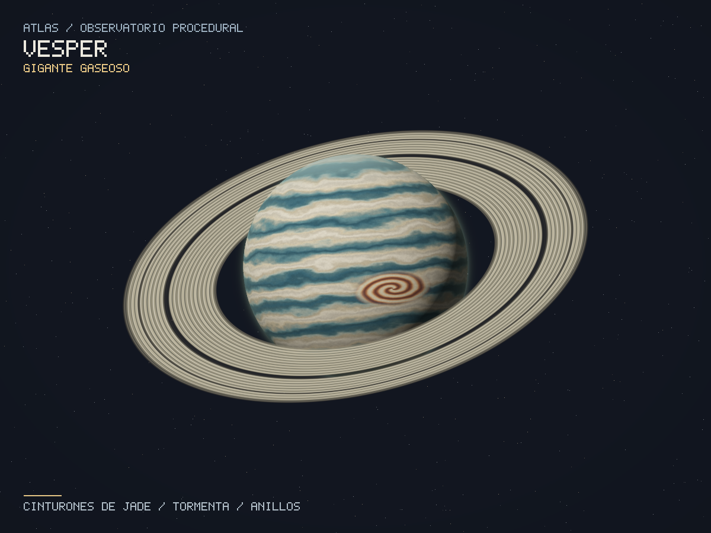
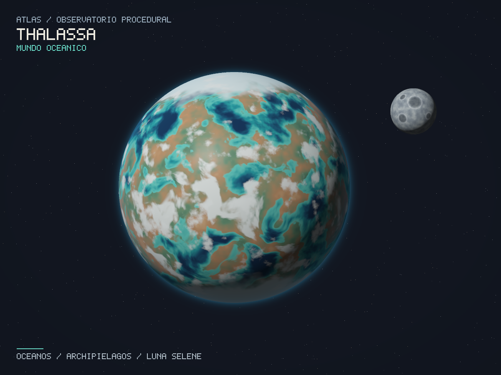
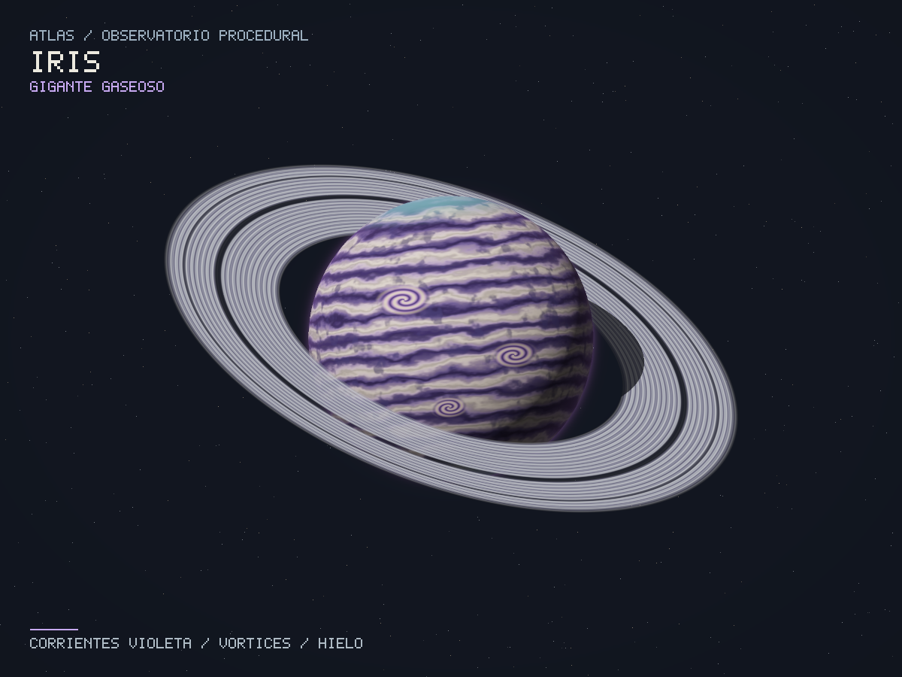
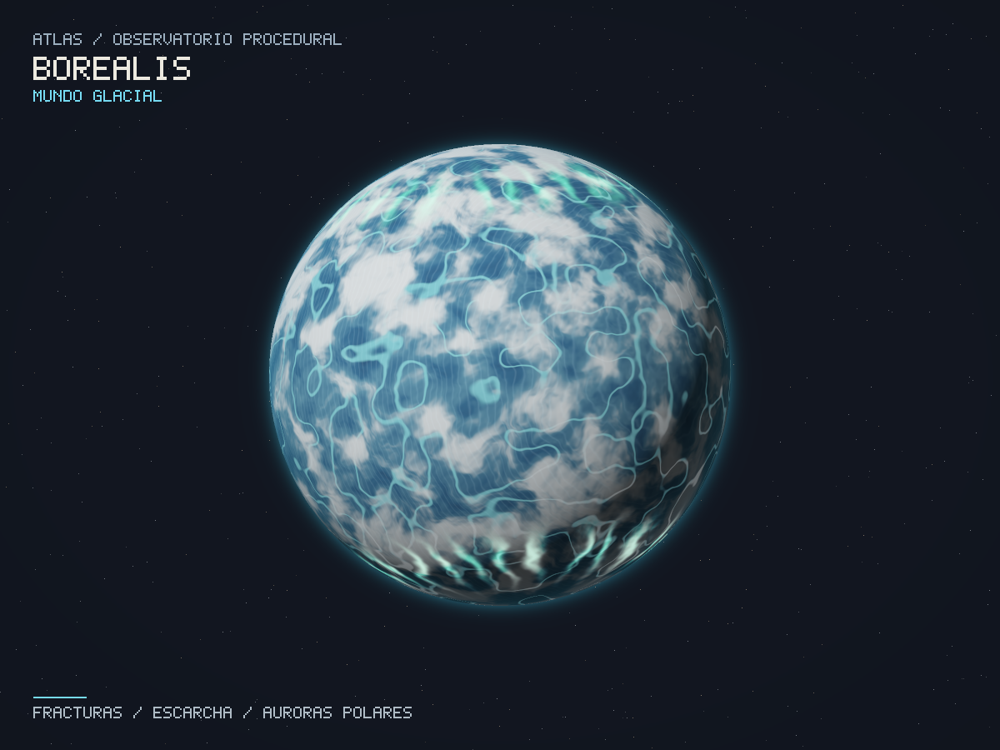
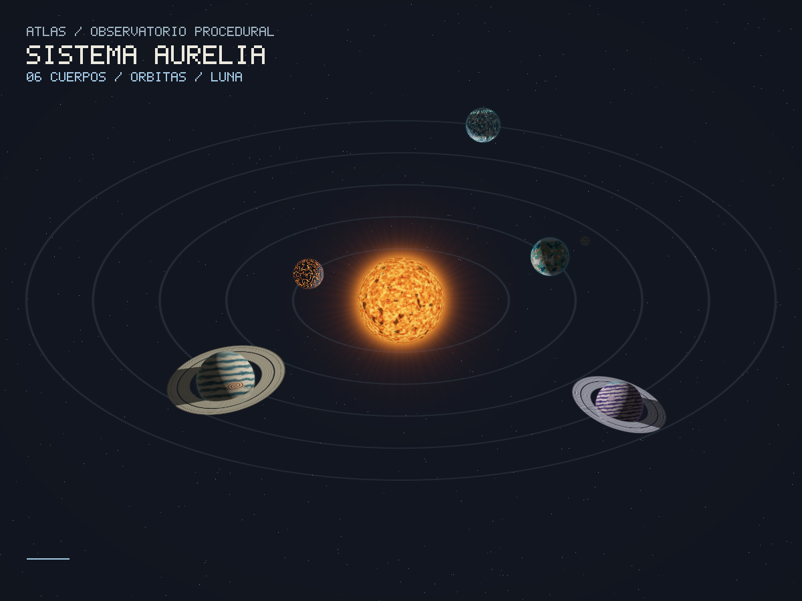

# ATLAS — Observatorio procedural

Laboratorio de shaders escrito en **Rust**: seis cuerpos celestes, dos sistemas de anillos y una luna. Todo se renderiza por software en la CPU. Los colores se calculan con funciones matemáticas; **no se cargan texturas, mapas ni archivos de materiales**.



## Ejecutar

Requisitos: Rust y Cargo, y una sesión gráfica para abrir la ventana. No se necesita Python. Las dependencias y sus versiones exactas están en `Cargo.toml` y `Cargo.lock`.

```sh
cargo run --release --locked
```

Se abre Vesper. Es importante usar `--release` para la animación: los shaders evalúan varias octavas de ruido por cada píxel.

Para una computadora con menos capacidad:

```sh
cargo run --release --locked -- --width 640 --height 480
```

En Windows, el toolchain `stable-msvc` necesita las herramientas de compilación de C++ de Visual Studio. En Linux, `minifb` necesita las bibliotecas de desarrollo de X11/Wayland; en Debian/Ubuntu pueden instalarse con `sudo apt install build-essential pkg-config libx11-dev libxcursor-dev libxrandr-dev libxi-dev libwayland-dev libxkbcommon-dev`.

## Controles

| Tecla | Acción |
| --- | --- |
| `1` | Aurelia, estrella |
| `2` | Nyx, planeta rocoso volcánico |
| `3` | Thalassa, planeta oceánico con luna |
| `4` | Vesper, gigante gaseoso con anillos |
| `5` | Iris, gigante gaseoso con anillos |
| `6` | Borealis, planeta glacial |
| `←` / `→` | Cuerpo anterior / siguiente |
| `O` | Alternar entre un cuerpo y el sistema solar |
| `Espacio` | Pausar / reanudar rotación, órbitas y animación de shaders |
| `+` / `-` | Acercar / alejar; `+` también funciona con la tecla `=` |
| `R` | Reiniciar el tiempo y el zoom |
| `H` | Mostrar / ocultar títulos y controles |
| `S` | Guardar PNG del encuadre actual en `captures/`, sin los controles |
| `Esc` | Salir |

La ventana puede redimensionarse y conserva la proporción de la imagen. `--paused` permite iniciar con la animación detenida. La rotación mueve las coordenadas del shader con el cuerpo; los continentes no se deslizan sobre la esfera. Las nubes de Thalassa tienen una rotación adicional.

## Diseños y capas de color

Cada fila describe operaciones que afectan el color del cuerpo. La iluminación, el halo y los anillos son efectos adicionales y no se cuentan como capas de la esfera.

| Cuerpo | Tipo | Capas del shader |
| --- | --- | --- |
| **Aurelia** | Estrella requerida | 1. Convección y dominio deformado; 2. filamentos brillantes; 3. manchas solares; 4. arcos de regiones activas; 5. turbulencia fina. |
| **Nyx** | Rocoso requerido | 1. Basalto multiescala; 2. estratos y cordilleras por color; 3. fallas de lava con temperatura variable; 4. cuencas y bordes de cráteres; 5. minerales oxidados. |
| **Vesper** | Gaseoso requerido | 1. Turbulencia de latitud; 2. cinturones de jade y ocre; 3. filamentos de nubes altas; 4. anticiclón con espiral; 5. grano fino; 6. bruma polar. |
| **Thalassa** | Planeta extra 1 | 1. Continentes y archipiélagos; 2. profundidad oceánica y costas; 3. vegetación, desiertos y cumbres; 4. casquetes polares; 5. frentes nubosos. |
| **Iris** | Planeta extra 2 | 1. Corrientes violetas; 2. filamentos claros; 3. nubes profundas; 4. tres vórtices; 5. bruma polar cian. |
| **Borealis** | Planeta extra 3 | 1. Hielo azul; 2. fracturas; 3. nieve y escarcha; 4. estrías cristalinas; 5. cortinas de aurora animadas. |

Las capas están identificadas en los comentarios de [`src/shaders.rs`](src/shaders.rs). `noise` es ruido de valores 3D con interpolación suave y hash entero; `fbm` suma distintas frecuencias. La deformación de dominio usa un ruido para modificar las coordenadas de otro, evitando patrones demasiado regulares. El ruido 3D no presenta una costura de longitud como un mapa UV.

### Aurelia — estrella

Plasma cálido, células de convección y regiones magnéticas. Es emisiva: su brillo no depende de una luz externa. Se añade oscurecimiento hacia el limbo y una corona calculada analíticamente.



### Nyx — mundo volcánico

Basalto frío atravesado por fallas incandescentes. La lava conserva luminosidad en el lado nocturno. Los cráteres se dibujan con distancias sobre la esfera: su aspecto de relieve proviene exclusivamente del color.



### Vesper — gigante de jade

Bandas de crema y verde petróleo con un anticiclón cobrizo. Sus anillos muestran bandas radiales, dos divisiones oscuras y transparencia variable. El planeta proyecta sombra sobre los anillos y los anillos atenúan la luz que llega al planeta.



### Thalassa y Selene — océano y luna

Océanos turquesa, archipiélagos cobrizos, hielo polar y nubes móviles. **Selene es una esfera independiente**, con radio, centro, shader de cráteres y órbita propios. Participa en las pruebas de profundidad y las sombras.



### Iris — gigante violeta

Corrientes moradas, pequeños vórtices y neblina cian. Tiene otro objeto de anillos, con inclinación y paleta de hielo diferentes de los de Vesper.



### Borealis — mundo glacial

Hielo de varias profundidades, escarcha y fracturas luminosas. Las cortinas de aurora cambian con el tiempo y aportan emisión en las latitudes altas.



## Sistema solar, rotación y traslación

`O` muestra los seis cuerpos simultáneamente. Aurelia ilumina los planetas desde el centro. Las órbitas están inclinadas respecto de la cámara y los cuerpos exteriores se trasladan más lentamente. Selene orbita Thalassa mientras ambos se trasladan alrededor de la estrella. Las escalas y velocidades se eligieron para la composición artística.



## Generar las capturas

Las imágenes incluidas fueron exportadas **por este programa**, a partir del mismo renderer que usa la ventana. Los PNG son resultados de salida; nunca se leen para dibujar un planeta.

Regenerar los seis cuerpos, la vista del sistema, el catálogo y la imagen para el concurso:

```sh
cargo run --release --locked -- --all --output docs/screenshots --width 1200 --height 900 --samples 2
```

Exportar un cuerpo sin abrir ventana:

```sh
cargo run --release --locked -- --render --body nyx --output captures/nyx.png
```

Elegir un instante y exportar sin títulos:

```sh
cargo run --release --locked -- --render --body borealis --time 8 --no-hud --samples 2 --output captures/borealis.png
```

`--samples 2` usa cuatro rayos por píxel para suavizar siluetas, fracturas y bandas. El tiempo predeterminado es cero, así que las capturas se pueden reproducir. En `--all`, Selene conserva una posición de presentación fija y los cuerpos sí usan el tiempo elegido para su rotación. `--help` muestra todas las opciones.

**Selección para el concurso:** [Vesper sin interfaz](docs/screenshots/concurso.png). El archivo queda listo para compartir en Discord.

## Cómo funciona el renderer

1. Se genera un rayo ortográfico por muestra del píxel.
2. Se resuelven en CPU las intersecciones rayo–esfera y se conserva la menor profundidad positiva.
3. El punto de intersección y la normal se transforman al espacio local del objeto, aplicando la rotación inversa.
4. `shade(body, p, time)` evalúa las capas y devuelve color y emisión.
5. Se calculan iluminación difusa, sombras por otros cuerpos y atenuación de luz por anillos. La emisión conserva el brillo de estrellas, lava y auroras.
6. Los anillos se intersectan como planos con un hueco circular, se ordenan por profundidad y se componen de atrás hacia delante con su opacidad procedural.
7. Se aplica exposición y gamma de visualización; el framebuffer se presenta con `minifb` o se exporta a PNG.

Se utiliza **ray casting analítico por software**, con esferas matemáticas, sin requerir un OBJ. Los anillos (`Ring`) y la luna (`Sphere` con `Body::Moon`) son objetos geométricos separados de los planetas. No se modifica el relieve de la esfera: los detalles del terreno y los cráteres se crean variando colores.

La evaluación se divide entre hilos de CPU con `std::thread`. No se usa OpenGL, Vulkan, un motor 3D ni shaders de GPU. `minifb` presenta píxeles y captura teclas; `image` escribe PNG y compone el catálogo. La pequeña fuente del HUD está definida en código y no interviene en los shaders.

| Archivo | Responsabilidad |
| --- | --- |
| `src/main.rs` | Ventana, controles, argumentos y exportación |
| `src/math.rs` | Vectores, rotaciones, interpolación y paletas |
| `src/noise.rs` | Hash, ruido 3D y fBm |
| `src/scene.rs` | Cuerpos, geometría separada y órbitas |
| `src/shaders.rs` | Seis shaders, shader lunar y bandas de anillos |
| `src/renderer.rs` | Intersecciones, profundidad, sombras, iluminación y framebuffer |
| `src/hud.rs` | Títulos e instrucciones de teclado |
| `docs/screenshots/` | Capturas reproducibles para la entrega |

## Verificación

```sh
cargo fmt --check
cargo clippy --locked --all-targets -- -D warnings
cargo test --locked
```

Las pruebas comprueban continuidad del ruido en coordenadas negativas, valores finitos en los shaders y sus polos, intersecciones desde dentro y fuera de esferas, el hueco de los anillos y rayos paralelos al plano, sombras del planeta e independencia de la profundidad respecto del orden de los cuerpos. También validan errores de la línea de comandos.

Prueba corta de apertura de la ventana, con cierre automático tras tres cuadros:

```sh
cargo run --release --locked -- --paused --frames 3
```

## Criterios de la entrega

| Criterio | Implementación |
| --- | --- |
| Estrella, rocoso y gaseoso | Aurelia, Nyx y Vesper |
| Complejidad por capas | Cinco o más operaciones de color por cuerpo, descritas arriba |
| Tres planetas adicionales | Thalassa, Iris y Borealis |
| Anillos procedurales | Vesper e Iris, con objetos independientes y sombras |
| Una luna | Selene alrededor de Thalassa |
| Rotación y traslación opcionales | Rotación individual, órbitas del sistema y órbita lunar |
| Capturas en README | Incluidas para los seis cuerpos y el sistema |

La creatividad y la puntuación final corresponden a la evaluación del docente; la consigna limita la nota a 100.

Para entregar en GitHub deben incluirse `Cargo.toml`, `Cargo.lock`, `src/`, `README.md`, `.gitignore` y `docs/screenshots/`. `target/` y las capturas personales de `captures/` están excluidos mediante `.gitignore`.
